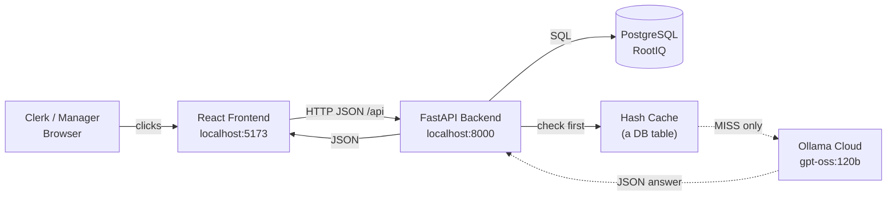
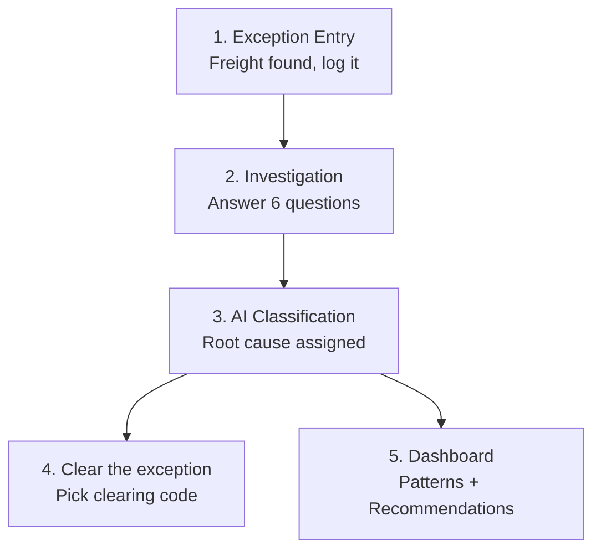
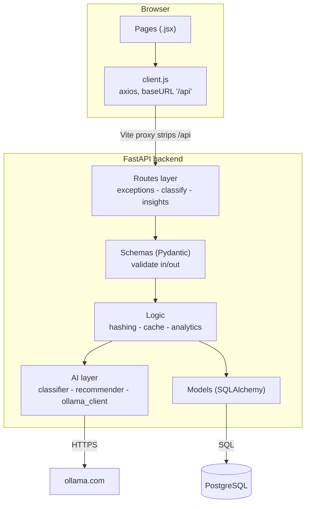
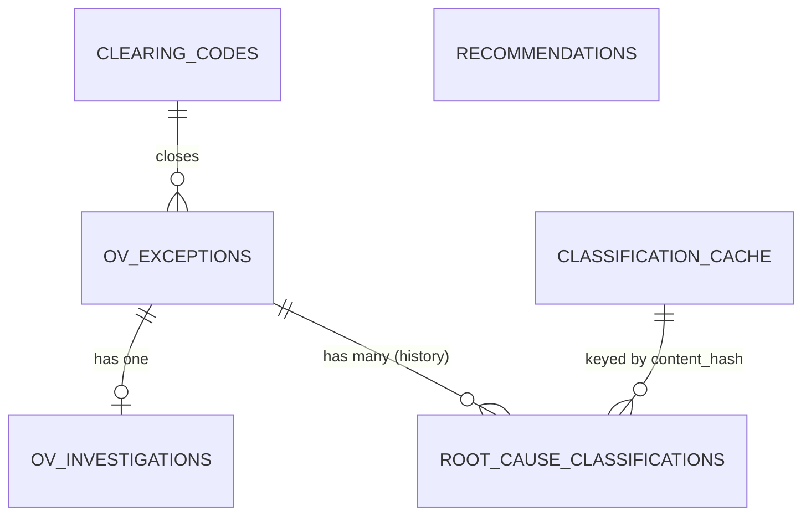
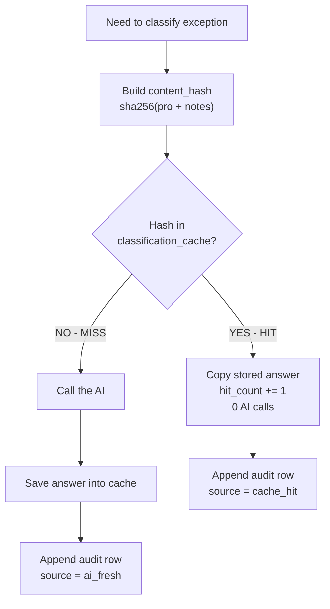
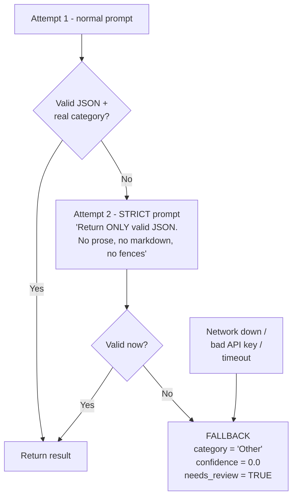
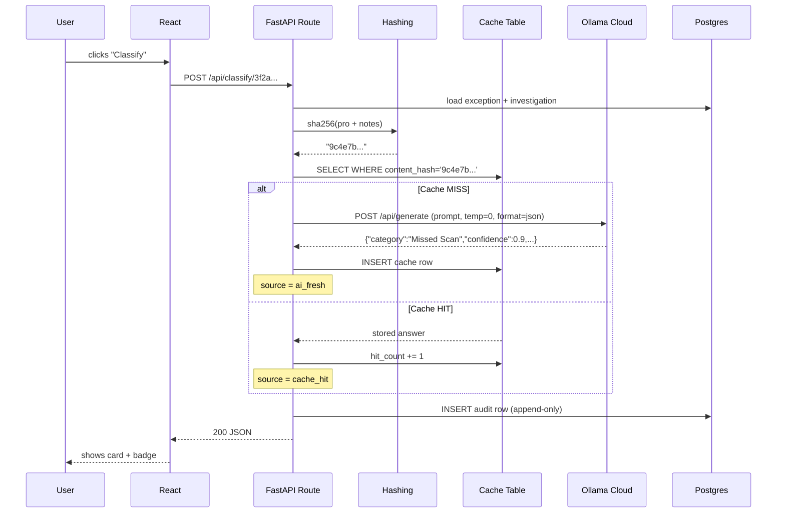
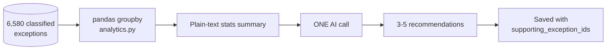

# OV Exception — AI Root Cause & Prevention POC
## Complete Application Guide (Functional + Technical)

> **Purpose of this document:** explain how the application works end-to-end, in plain language,
> so that anyone can understand it deeply and confidently explain it to a team.
> No advanced AI knowledge assumed.

**Contents**

1. [The Business Problem](#part-1--the-business-problem-why-this-exists)
2. [The Big Picture](#part-2--the-big-picture-one-diagram)
3. [Functional Flow (user's perspective)](#part-3--functional-flow-what-a-human-actually-does)
4. [Technical Architecture](#part-4--technical-architecture-layer-by-layer)
5. [The Database](#part-5--the-database-6-tables)
6. [The Cache](#part-6--the-cache-the-money-saver)
7. [How the AI Works](#part-7--how-the-ai-actually-works)
8. [How the APIs Work](#part-8--how-the-apis-work)
9. [The Recommendations Engine](#part-9--the-second-ai-feature-recommendations)
10. [A Complete Real-World Example](#part-10--a-complete-real-world-example)
11. [Parameter Cheat Sheet](#part-11--parameter-cheat-sheet)
12. [Honest Caveats for the Demo](#part-12--things-to-say-honestly-when-you-present)
13. [One-Paragraph Version](#one-paragraph-version-for-a-hallway-explanation)
14. [Appendix: Running the App](#appendix--running-the-app)

---

## PART 1 — The Business Problem (Why this exists)

In LTL freight, an **OV = "Overage"** exception means: **extra freight showed up that nobody ordered.**

A skid arrives at a terminal, and there are 14 cartons when the paperwork says 12. Or a loose box is
sitting in a bay with no label. Someone has to figure out *whose* freight it is and *why* it ended up there.

Today an OS&D clerk investigates each one by hand, writes free-text notes, and closes it with a
2-letter "clearing code". **Nobody ever aggregates the notes.** So the company fixes the same 500
problems one at a time, forever, and never learns "Terminal MPS has a labeling problem."

**This app reads those notes with an AI, assigns a root cause category, and then tells you what to fix.**

---

## PART 2 — The Big Picture (One diagram)



**Five parts, that's it:**

| Part | What it is | Its one job |
|---|---|---|
| **Frontend** | React + Vite | Show screens, collect clicks |
| **Backend** | FastAPI (Python) | Rules, orchestration, the "brain stem" |
| **Database** | PostgreSQL | Remember everything, forever |
| **Cache** | A Postgres *table* | Stop us paying the AI twice for the same question |
| **AI** | Ollama Cloud LLM | Read English notes → return a category |

> **Key insight to tell your team:** The AI is **not** the application. The AI is one function call
> inside the application, that takes text in and gives a category out. Everything else is ordinary
> web software.

---

## PART 3 — Functional Flow (What a human actually does)

### The 4 screens and the journey



### Step 1 — An exception is created

A clerk finds unexpected freight. They record: PRO number, origin/destination terminal, shipper,
consignee, where it was found (**trailer or bay**), pieces, weight, commodity, hazmat flag,
value range, and free-text details.

→ Screen: `frontend/src/pages/ExceptionsPage.jsx`

### Step 2 — Investigation (this is where the AI's fuel comes from)

The clerk works through **6 yes/no questions**, and — critically — **types a sentence explaining each
answer.** These six come straight from the real AS400 system:

| Question key | Shown to the user as |
|---|---|
| `od400Check` | Was the OD400 checked? |
| `billOfLadingCheck` | Was the bill of lading checked for errors? |
| `drCheck` | Was the delivery receipt checked? |
| `psCheck` | Was a packing slip found and checked? |
| `consigneeCheck` | Was the consignee contacted? |
| `shipmentCheck` | Were related shipments checked? |

→ Defined in `backend/app/questions.py`

The backend **glues these 6 answers into one paragraph** called `combined_notes_text`.
**That paragraph is the only thing the AI reads.**

### Step 3 — Classify

The user clicks **"Classify"**. Two seconds later a card appears:

> **Missed Scan** · confidence 0.90 · `AI FRESH`
> *"Why?" → Freight moved through checkpoints with no scan recorded at any of them.*

If the AI is wrong, the user picks the correct category from a dropdown → this is saved as a
**human override**. Nothing is deleted; it's added as a new row in the history.

→ Screen: `frontend/src/pages/ExceptionDetailPage.jsx`

### Step 4 — Clear it

Pick a clearing code (SV, CG, DA…), exception closes.

### Step 5 — The Dashboard (the actual business value)

- A bar chart: which root causes are most common
- 4 tiles: total classified, cache hit rate, AI calls saved, accuracy
- **3–5 AI-written prevention recommendations**, each clickable to see the exact exceptions that justify it

→ Screen: `frontend/src/pages/DashboardPage.jsx`

---

## PART 4 — Technical Architecture (Layer by layer)



### Why the folders are split this way

| Folder/file | Responsibility |
|---|---|
| `backend/app/routes/` | HTTP only — URLs, status codes. No business logic. |
| `backend/app/schemas.py` | The **contract**. Validates incoming JSON, shapes outgoing JSON. |
| `backend/app/models.py` | The **tables**. What Postgres physically stores. |
| `backend/app/dedup/` | Hashing + cache. Saves money. |
| `backend/app/ai/` | Everything LLM. |
| `backend/app/analytics.py` | pandas aggregation for the dashboard. |

> **The single most important design rule here:** all AI network traffic goes through **one file** —
> `backend/app/ai/ollama_client.py`. If you want to swap Ollama for OpenAI or Bedrock tomorrow, you
> edit that one file and nothing else breaks.

---

## PART 5 — The Database (6 tables)



| Table | Holds | Note |
|---|---|---|
| `ov_exceptions` | The freight facts + `content_hash` | 6,580 rows today |
| `ov_investigations` | The 6 Q&A steps + `combined_notes_text` | The AI's input lives here |
| `root_cause_classifications` | **Append-only audit log** | 1 row per classification *event* |
| `classification_cache` | **1 row per unique text** + `hit_count` | This IS the cache |
| `clearing_codes` | 15 two-letter codes | Reference data |
| `recommendations` | AI prevention advice + evidence IDs | |

### Why TWO classification tables? (Common question)

- `classification_cache` = **"what is the answer to this question?"** — one row per unique question,
  updated in place.
- `root_cause_classifications` = **"who asked, when, and what did they get?"** — never updated,
  only appended.

This is what makes overrides safe and makes cache-hit-rate measurable.

---

## PART 6 — The Cache (the money-saver)

Every AI call costs time (~2–4 seconds) and money. Many exceptions are **literally identical** —
same PRO, same notes (re-entered, re-opened, duplicated by the AS400 feed).

### How the fingerprint is made

```python
payload = f"{normalize(pro_number)}|{normalize(combined_notes_text)}"
content_hash = sha256(payload).hexdigest()
```

→ `backend/app/dedup/hashing.py`

`normalize()` = lowercase + trim + collapse repeated spaces. So `"No Error"` and `"no    error"`
produce the **same** fingerprint.



→ Logic in `classify_one()` at `backend/app/routes/classify.py`

**Two honest limitations to state out loud:**

1. It's **exact-match only**. "box was crushed" and "carton was crushed" are different fingerprints.
   Catching those needs embeddings — that's Phase 2.
2. `additional_details` is **sent to the AI but deliberately excluded from the fingerprint**, so
   trivial cosmetic edits don't destroy your cache hit rate.

---

## PART 7 — How the AI Actually Works

### 7.1 The model and its settings

| Parameter | Value | Where defined | Why |
|---|---|---|---|
| `OLLAMA_BASE_URL` | `https://ollama.com` | `backend/.env` | Hosted, no GPU needed locally |
| `OLLAMA_MODEL` | `gpt-oss:120b` | `backend/.env` | 120-billion-parameter open model |
| `OLLAMA_API_KEY` | *(secret)* | `backend/.env` | Sent as `Authorization: Bearer …` |
| `OLLAMA_TIMEOUT_SECONDS` | `180` | `backend/.env` | Big model, be patient |
| **`temperature`** | **`0.0`** | `backend/app/ai/classifier.py` | **Most important one** — see below |
| `format` | `"json"` | `backend/app/ai/ollama_client.py` | Forces JSON-only output |
| `stream` | `false` | `backend/app/ai/ollama_client.py` | We want one complete answer |

All read into a typed `Settings` object in `backend/app/config.py`.

> **Explaining `temperature` to a non-AI audience:** temperature is the model's "creativity dial",
> 0 to 1. At `0.9` it's a brainstorming partner — ask twice, get two different answers. At **`0.0`**
> it's a calculator — same input always gives the same output. For classification you want a
> calculator, so we pin it at **0**. *(The recommender deliberately omits it, so it can be a bit more
> creative when writing advice.)*

### 7.2 The 12 categories the AI must choose from

The model **cannot invent a category**. It must return one of exactly these:

```
Improper Packaging · Missed Scan · Data Entry / Scan Mismatch · Misrouting
Load Swap / Co-mingled Shipment · Handling Damage · Documentation Errors
Shipper Load & Count Discrepancy · Consignee Issue · Carrier Error
Labeling Error · Other
```

→ `backend/app/ai/taxonomy.py`

Each one has a written definition, and there are **9 hand-written worked examples**
("few-shot examples") that get pasted into every prompt. Showing the model 9 solved examples is
dramatically more reliable than just describing the task.

### 7.3 The exact prompt we send

**System prompt** (sets the persona):

> *"You are an LTL freight OS&D analyst. You classify the root cause of OVERAGE (OV) exceptions from
> investigation notes. You answer only with a single JSON object."*

**User prompt** (assembled fresh each time):

```text
Classify the root cause of this overage (OV) freight exception.

ALLOWED CATEGORIES (use the exact string, nothing else):
- Improper Packaging: Packaging failed or came apart in transit...
- Missed Scan: Freight was never scanned at a checkpoint where it should have been.
  ... [all 12 with definitions] ...

EXAMPLES:
  ... [9 worked examples: notes -> JSON answer] ...

Rules:
- "category" MUST be exactly one of the allowed category strings above.
- "confidence" is a float between 0 and 1.
- "reasoning" is one or two sentences citing the evidence in the notes.
- If the notes are too thin to determine a cause, use "Other" with a low confidence.

INVESTIGATION NOTES:
<<< the clerk's 6 answers go here >>>

JSON:
```

→ `build_prompt()` in `backend/app/ai/classifier.py`

### 7.4 What comes back

```json
{
  "category": "Missed Scan",
  "confidence": 0.9,
  "reasoning": "Freight moved through checkpoints with no scan recorded at any of them."
}
```

### 7.5 The safety ladder (what happens when AI misbehaves)

LLMs sometimes wrap JSON in markdown fences, add chatty preamble, or invent a category. We never let
that crash the app:



Notice it also **digs JSON out of surrounding text** with a regex before giving up. And if the whole
AI service is offline, every record simply comes back as `Other` + `needs_review` — **the app never
crashes, it just degrades.**

---

## PART 8 — How the APIs Work

### 8.1 The connection chain

The frontend never hardcodes `localhost:8000`. It calls `/api/...`, and Vite's dev proxy rewrites it:

```text
Browser  ->  GET /api/ov-exceptions
Vite     ->  strips "/api"  ->  GET http://localhost:8000/ov-exceptions
FastAPI  ->  matches route  ->  returns JSON
```

CORS is controlled by `CORS_ORIGINS=http://localhost:5173` in `.env` → applied in `backend/app/main.py`.

### 8.2 Full endpoint list

| Method | Endpoint | Purpose |
|---|---|---|
| `GET` | `/health` | Is DB + Ollama alive? |
| `GET` | `/investigation-questions` | The 6 questions for the form |
| `GET` | `/clearing-codes` | The 15 closing codes |
| `POST` | `/ov-exceptions` | Create an exception |
| `GET` | `/ov-exceptions` | List, filtered + paged |
| `GET` | `/ov-exceptions/{id}` | Full detail |
| `POST` | `/ov-exceptions/{id}/investigation` | Save the 6 answers |
| `POST` | `/ov-exceptions/{id}/clear` | Close it |
| `GET` | `/classify/taxonomy` | The 12 categories |
| `POST` | `/classify/{id}` | **Classify one** |
| `POST` | `/classify/batch` | **Classify many** (`?limit=`, `?force=`) |
| `GET` | `/classify/{id}/history` | Full audit trail |
| `POST` | `/classify/{id}/override` | Human correction |
| `GET` | `/insights/distribution` | Chart data |
| `GET` | `/insights/cache-stats` | Hit rate, calls saved |
| `GET` | `/insights/accuracy` | vs. hand-labeled set |
| `GET` | `/insights/filters` | Dropdown options |
| `POST` | `/insights/recommendations/generate` | **Ask AI for advice** |
| `GET` | `/insights/recommendations` | Read saved advice |
| `GET` | `/insights/recommendations/{id}/evidence` | Proof behind advice |

FastAPI auto-generates live docs at **http://localhost:8000/docs** — great for demos.

### 8.3 A request traced end to end

**`POST /classify/3f2a…`**



**Response the frontend receives:**

```json
{
  "id": "b81f...",
  "ov_exception_id": "3f2a...",
  "category": "Missed Scan",
  "confidence": 0.9,
  "reasoning": "Freight moved through checkpoints with no scan recorded at any of them.",
  "model_used": "ollama:gpt-oss:120b",
  "source": "ai_fresh",
  "needs_review": false,
  "classified_at": "2026-09-16T10:22:41Z"
}
```

The `source` field is what draws the green **AI FRESH** vs blue **CACHE HIT** badge in the UI.

---

## PART 9 — The Second AI Feature: Recommendations

This one is different, and the difference matters.

**Classification reads ONE exception's text. Recommendations read NO text at all — only numbers.**



We send the model a **statistics report**, like:

```text
Scope: terminal=all, commodity=all, window=last 90 days
Total classified OV exceptions: 80
Root cause distribution:
  - Missed Scan: 18 (22.5%)
  - Improper Packaging: 12 (15.0%)
Category by origin terminal:
  - origin_terminal=MPS, category=Labeling Error -> 9
```

And ask for actions *"a terminal manager could act on this week."*

Each saved recommendation stores **`supporting_exception_ids`** — the actual exception IDs behind it.
That's what makes the dashboard's "show me the proof" click-through work, and it's what stops this
being an AI that just makes things up.

→ `backend/app/ai/recommender.py` + `backend/app/analytics.py`

---

## PART 10 — A Complete Real-World Example

**Real record from the imported data — OSD #907082312:**

**① Freight arrives:** PRO `12035975310`, MPS → ACA, cosmetics/toilet preparations, found in a bay.

**② Clerk investigates** — answers the 6 questions:

| Question | Y/N | What they typed |
|---|---|---|
| OD400 checked? | N | "created by OSD" |
| BOL checked? | Y | "no error" |
| Delivery receipt checked? | Y | "it was signed cleared but the pc do not match" |
| Packing slip found? | N | "no packing list was found" |
| Consignee contacted? | Y | "yes reached out by email … no response" |
| Related shipments checked? | Y | "all shipments were delivered clear" |

**③ Backend builds `combined_notes_text`:**

```text
Was the OD400 checked? [N] created by OSD
Was the bill of lading checked for errors? [Y] no error
Was the delivery receipt checked? [Y] it was signed cleared but the pc do not match
Was a packing slip found and checked? [N] no packing list was found
Was the consignee contacted? [Y] yes reached out by email ... no response
Were related shipments checked? [Y] all shipments were delivered clear
```

**④ Fingerprint:** `sha256("12035975310|was the od400 checked? [n] created by osd…")` → `a7f3…`

**⑤ Cache lookup:** not found → MISS.

**⑥ AI call:** prompt (12 categories + 9 examples + those notes) → `gpt-oss:120b` at temperature 0.

**⑦ AI returns:**

```json
{"category": "Shipper Load & Count Discrepancy", "confidence": 0.85,
 "reasoning": "The delivery receipt was signed clear but the piece count does not match, and no packing slip was present to reconcile."}
```

**⑧ Saved twice:** cache row `a7f3…` (so the next identical record is free) + audit row
(`source = ai_fresh`).

**⑨ User sees the card.** Agrees. Clears it with code **CG**.

**⑩ On the dashboard**, this joins 40 other count-mismatch cases and the AI writes:

> *"Require a piece-count verification scan at MPS outbound before sealing for ACA — 41 overages in
> 90 days trace to count discrepancies signed clear at delivery."*

**⑪ Later, a duplicate arrives** with the same PRO and same notes → fingerprint `a7f3…` →
**CACHE HIT** → answer returned in ~5 milliseconds, **zero AI cost**.

---

## PART 11 — Parameter Cheat Sheet

### Environment (`backend/.env` — never committed)

| Variable | Purpose |
|---|---|
| `DATABASE_URL` | Which Postgres to use |
| `OLLAMA_BASE_URL` | Where the AI lives |
| `OLLAMA_MODEL` | Which brain to use |
| `OLLAMA_API_KEY` | Authentication |
| `OLLAMA_TIMEOUT_SECONDS` | How long before giving up |
| `CORS_ORIGINS` | Which website may call the API |

### In code

| Parameter | Value | File |
|---|---|---|
| `temperature` | `0.0` | `backend/app/ai/classifier.py` |
| `format` | `"json"` | `backend/app/ai/ollama_client.py` |
| `ROOT_CAUSE_TAXONOMY` | 12 categories | `backend/app/ai/taxonomy.py` |
| `FEW_SHOT_EXAMPLES` | 9 examples | `backend/app/ai/taxonomy.py` |
| `INVESTIGATION_QUESTIONS` | 6 AS400 checks | `backend/app/questions.py` |
| `limit` (batch) | default 200, max 1000 | `backend/app/routes/classify.py` |
| `days` (insights) | default 90 | `backend/app/analytics.py` |

### Key response fields

| Field | Meaning |
|---|---|
| `source` | `ai_fresh` / `cache_hit` / `human_override` |
| `needs_review` | `true` = AI failed, a human must look |
| `confidence` | 0–1, the model's own certainty |
| `model_used` | e.g. `ollama:gpt-oss:120b` or `human:jdoe` |
| `content_hash` | The dedup fingerprint |

---

## PART 12 — Things to Say Honestly When You Present

These will come up, and having the answer ready is what makes the demo credible:

1. **"The 100% accuracy number is on synthetic data."** It came from 25 hand-written templates, which
   are far cleaner than real analyst prose. Don't quote it externally. The real accuracy number has to
   come from hand-labeling real records.
2. **Dedup is exact-match only.** Reworded duplicates won't hit. Semantic dedup via embeddings is Phase 2.
3. **Only 3,380 of the 6,500 real records have investigation text.** The other ~3,120 have nothing for
   the AI to read and will correctly return `Other`. Classify the subset.
4. **The AI never decides anything final.** Humans can override, and every override is preserved as history.
5. **The real export contains genuine PII** — real consignee names and personal email addresses inside
   the notes — and classification transmits that text to `ollama.com`. **Clear this with data
   governance before any bulk classification run.** This is the one item on the list that is a blocker,
   not a caveat.

---

## One-Paragraph Version (for a hallway explanation)

> *"Clerks investigate overage freight and type notes. Our app hashes those notes into a fingerprint
> and checks a cache table. If we've seen identical notes before, we reuse the answer for free. If not,
> we send the notes to a 120-billion-parameter language model with a fixed list of 12 root causes and
> 9 worked examples, at temperature zero so it behaves like a calculator, and it returns JSON with a
> category, a confidence and a one-line reason. We store that as an append-only audit record so humans
> can override it without losing history. Then we aggregate all the classifications with pandas, send
> the statistics back to the AI, and it writes 3–5 specific prevention actions — each one linked to the
> exact exceptions that prove it. Net effect: instead of fixing 6,500 problems one at a time, you fix
> the 5 causes behind them."*

---

## Appendix — Running the App

### Backend

```bash
cd backend
.venv/Scripts/python.exe -m uvicorn app.main:app --reload --port 8000
```

### Frontend

```bash
cd frontend
npm run dev          # http://localhost:5173
```

### Import the real data

```bash
cd backend
python -m app.seed.import_mock --dry-run            # map + count, writes nothing
python -m app.seed.import_mock                      # full 6,500-record load
python -m app.seed.import_mock --with-notes-only    # only rows with investigation text
python -m app.seed.import_mock --limit 300          # small demo slice
```

### Generate synthetic demo data instead

```bash
python -m app.seed.seed_data --count 80 --duplicates 8 --labeled 26 --reset
```

### Tests

```bash
cd backend && .venv/Scripts/python.exe -m pytest -q      # 24 tests
```

### Health check

```bash
curl http://localhost:8000/health
```

Expected:

```json
{"status":"ok","database":"127.0.0.1:5432/RootIQ","ollama":{"available":true,"model":"gpt-oss:120b","model_pulled":true}}
```
